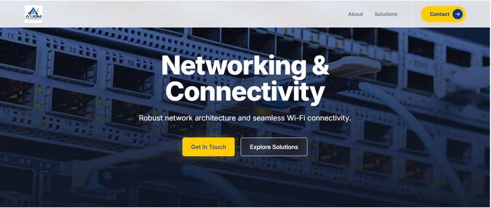
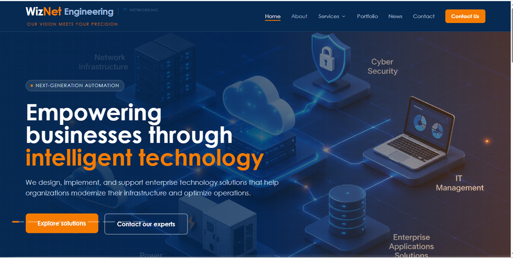

  
  
  

I design and propose enterprise IT, network and security solutions for client RFPs.
Alongside that, I do hands-on technical implementation: web and business systems that teams actually use.
I'm always learning, and I like turning real business needs into things that work.

Most of my work is for companies, so some of it is private. Here is what I've delivered.

<table>
<tr>
<td width="48%"></td>
<td valign="top"><b>Axiome Enterprise Solution</b> Responsive company website with service pages and a working contact form.  <code>React</code>  <a href="https://axiomenterprisesolution.com/">Visit the website</a></td>
</tr>
<tr>
<td width="48%"></td>
<td valign="top"><b>WizNet Engineering</b> Business website presenting the company's services and portfolio.  <code>React</code> <code>Express</code>  <a href="https://wiznetplc.com/">Visit the website</a></td>
</tr>
<tr>
<td width="48%"></td>
<td valign="top"><b>Enterprise Management System</b> One platform for accounts, opportunities, bids and tenders, vendors, schedules and team performance, with a live dashboard and deadline and bond-expiry alerts. Internal use only, so only the sign-in screen is shown.  <code>Python</code> <code>React</code> <code>Vite</code> <code>PostgreSQL</code> <code>Docker</code></td>
</tr>
</table>

Also: **Corporate Website** (not publicly hosted) built with `Next.js` `React` `NestJS` `PostgreSQL`, and my graduation project, a **Smart Plant Watering System** that automates watering from soil-moisture, temperature and light sensors ([repo](https://github.com/fikogit/Smart-plant-watering-system)).

**Education:** B.Sc. in Electrical and Computer Engineering (Communication Stream), Samara University, 2019 to 2023.

  
  

