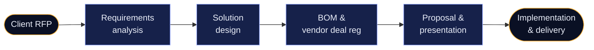
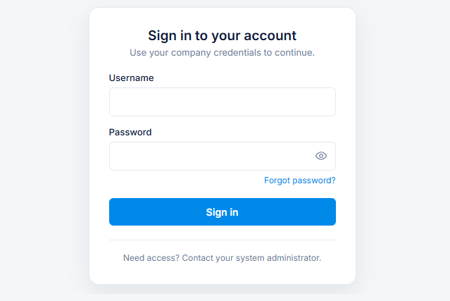

 

## About

I design and propose enterprise IT, network and security solutions for client RFPs, then stay close enough to the work to configure, deliver and support what I designed. Alongside that, I build web and business systems that teams actually use.

I like turning real business needs into things that work.

## How I work

## Professional work

| Role | Period |
|---|---|
| **Enterprise Engineer** | May 2025 to present |
| **Network and Security Pre-Sales Engineer** | Jan 2025 to May 2025 |
| **Pre-Sales Engineer** | Jun 2024 to Jan 2025 |

<table>
<tr>
<td width="50%" valign="top"><b>Solution proposals</b> Enterprise IT, network and security proposals for client RFPs.</td>
<td width="50%" valign="top"><b>Bill of Materials</b> Configuring solutions and generating BOMs for infrastructure projects.</td>
</tr>
<tr>
<td valign="top"><b>Solution design</b> Tailoring each proposal to the client's requirements.</td>
<td valign="top"><b>Vendor engagement</b> Deal registration and partner management.</td>
</tr>
<tr>
<td valign="top"><b>Pre-sales support</b> Technical documentation, walkthroughs and client presentations.</td>
<td valign="top"><b>Technical implementation</b> Hands-on configuration and delivery support for network, security and hardware solutions.</td>
</tr>
</table>

  
  
  
  
  
  
  
  
  

## Software projects

Most of my work is for companies, so some of it is private. Here is what I've delivered.

<table>
<tr>
<td width="48%"></td>
<td valign="top"><b>Axiome Enterprise Solution</b> Responsive company website with service pages and a working contact form.  <code>React</code>  <a href="https://axiomenterprisesolution.com/">Visit the website →</a></td>
</tr>
<tr>
<td width="48%"></td>
<td valign="top"><b>WizNet Engineering</b> Business website presenting the company's services and portfolio.  <code>React</code> <code>Express</code>  <a href="https://wiznetplc.com/">Visit the website →</a></td>
</tr>
<tr>
<td width="48%"></td>
<td valign="top"><b>Enterprise Management System</b> One platform for accounts, opportunities, bids and tenders, vendors, schedules and team performance, with a live dashboard and deadline and bond-expiry alerts. Internal use only, so only the sign-in screen is shown.  <code>Python</code> <code>React</code> <code>Vite</code> <code>PostgreSQL</code> <code>Docker</code></td>
</tr>
</table>

<b>More projects</b>

 

- **Corporate Website** (not publicly hosted): `Next.js` `React` `NestJS` `PostgreSQL`
- **Smart Plant Watering System**, my graduation project. It automates watering from soil-moisture, temperature and light sensors. [View repo →](https://github.com/fikogit/Smart-plant-watering-system)

  

## Certifications

<table>
<tr>
<td width="33%" valign="top"><b>Sangfor</b> Certified Solution Architect, Cloud (SCSA)</td>
<td width="33%" valign="top"><b>Cisco</b> Certified Network Associate (CCNA)</td>
<td width="33%" valign="top"><b>Nutanix</b> Certified Professional, Multicloud Infrastructure v6</td>
</tr>
<tr>
<td valign="top"><b>Fortinet</b> FortiGate 7.4 Administrator</td>
<td valign="top"><b>Check Point</b> Harmony SaaS Technical Specialist and Harmony SASE Sales Specialist</td>
<td valign="top"><b>Lenovo</b> Infrastructure Professional Services and Support Services sales certifications, ISG ThinkSystem DM and DG Implementation Workshop</td>
</tr>
</table>

**Education:** B.Sc. in Electrical and Computer Engineering (Communication Stream), Samara University, 2019 to 2023.

## GitHub activity

  
  

  

## Contact

Open to roles that combine solution design with hands-on technical implementation.

